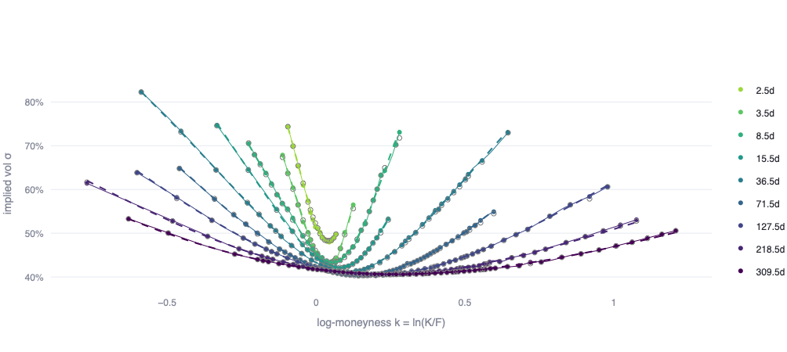

# Implied volatility surface builder

Builds implied volatility surfaces from live Deribit BTC option chains, from first principles: Black-76 inversion of every quote, quote cleaning with an explicit reason for every rejection, a baseline interpolated surface and an SVI surface, and butterfly and calendar arbitrage checks on both. A Streamlit app lets you explore the result.



*BTC smiles from the 18 Nov 2026 snapshot. Filled markers are IVs inverted at the mid, open markers are Deribit's mark IV, dashed lines are the SVI fits and thin lines the interpolated surface.*

## Results on a real snapshot

On the committed BTC snapshot (18 Nov 2026, 20:00 UTC, 944 instruments):

| | |
|---|---|
| Usable quotes | 345 across 9 expiries (2.5 to 309 days) |
| Rejected quotes | 407 in the money, 130 short expiry, 33 wide spread, 29 zero bid |
| Agreement with Deribit's `mark_iv` | median gap 0.07 vol points, 90th percentile 0.29 |
| Interpolated surface | 175 butterfly violations (9.7% of checked points), 0 calendar |
| SVI surface | 0 butterfly, 0 calendar violations; median IV misfit 0.07 vol points |

The project tells one story: naive interpolation through market implied vols produces a surface with negative implied densities, and fitting SVI slice by slice removes them while staying close to the quotes.

The small gaps to `mark_iv` are expected. This project inverts bid/ask mids, while Deribit inverts its own mark prices.

## Method

**Market set-up.** Deribit options are European options on BTC, quoted in BTC. Each premium is converted to forward-dollar terms (premium × F) and priced with Black-76 on the forward F, taken from Deribit's `underlying_price` for that expiry, with r = 0. Time to expiry is calendar seconds from the snapshot to the 08:00 UTC expiry, over a 365-day year, because the market trades around the clock.

**Quote selection.** Only out-of-the-money options are used (puts below the forward, calls above it), inverted at the mid price. Quotes are rejected for a zero bid, a relative spread above 50%, an expiry under two days, or a price outside the no-arbitrage bounds. Every quote keeps its row in the output with a reason code, so nothing is dropped silently. All thresholds are configurable.

**Implied vol solver.** Newton-Raphson on Black-76 vega, falling back to Brent's method when vega is tiny or Newton leaves its bracket. Prices below intrinsic or above the upper bound return NaN with a reason rather than a meaningless vol.

**Coordinates.** Everything works in log-moneyness k = ln(K/F), time T and total variance w = σ²T.

**Surfaces.** Both share one interface, `iv(k, T)` and `total_variance(k, T)`.
- *Interpolated:* a natural cubic spline in total variance through each expiry's points. This is the model-free baseline, and it is free to wiggle between quotes.
- *SVI:* a raw SVI slice (a, b, ρ, m, σ) per expiry, fitted by weighted least squares on total variance with 1/spread weights, bounds that keep every slice valid (b ≥ 0, |ρ| < 1, σ > 0, minimum variance ≥ 0), and a heuristic start with random restarts. Slices are interpolated linearly in w at fixed k across expiries and extrapolated flat in σ outside the quoted range.

**Arbitrage checks.** Butterfly arbitrage uses Durrleman's condition g(k) ≥ 0 on each slice. Calendar arbitrage checks that w is non-decreasing in T at fixed k. Both run over each expiry's quoted strike range.

## Testing

148 tests, all offline, written against public seams rather than internals:

- **Synthetic oracle.** Chains generated from known SVI parameters, with bid/ask noise, go through the full pipeline. The recovered SVI parameters and implied vols must match the truth within tolerance.
- **Black-76 round trips.** Price at a known σ, invert, and recover σ across a grid of moneyness, expiry and vol, plus put-call parity and edge cases (deep OTM, very short expiry, tiny vega, out-of-bounds prices).
- **Reason codes.** Deliberately bad quotes must come back with the right rejection reason.
- **Arbitrage detection.** Surfaces built to contain butterfly or calendar arbitrage must be flagged, and clean ones must not.
- **Real data.** On the committed snapshot, computed vols must agree with `mark_iv`, and SVI must show no more arbitrage than the interpolated surface.
- **Deribit client.** Tested against a recorded API response, including unit handling (`mark_iv` arrives in percent).

## Running it

Requires [uv](https://docs.astral.sh/uv/) and Python 3.13.

```
git clone https://github.com/milespadget/implied_volatility_surface_builder.git
cd implied_volatility_surface_builder
uv sync
uv run streamlit run app/streamlit_app.py
```

The app opens on a synthetic chain. Use **Fetch BTC chain from Deribit** in the sidebar to pull a live snapshot from the public API (no key needed). Snapshots are saved to `data/snapshots/` and appear in the data source picker. The sidebar also lets you change the filter thresholds and watch the surface respond.

Run the tests with:

```
uv run pytest
```

## Project layout

```
src/ivsurface/
  black76.py     pricing, vega and implied vol inversion
  chain.py       quote filtering and OTM selection
  svi.py         raw SVI and the per-expiry fitter
  surface.py     InterpolatedSurface and SVISurface
  arbitrage.py   butterfly (Durrleman g) and calendar checks
  pipeline.py    snapshot in, points, surfaces and arbitrage reports out
  data.py        Deribit client and Parquet snapshots
  synthetic.py   synthetic chains from known SVI parameters
app/
  streamlit_app.py
tests/
```

## Limitations and next steps

- SVI slices are fitted independently, so the surface has no built-in no-arbitrage guarantee across expiries. It happens to be arbitrage-free on the test snapshot. SSVI would build that guarantee in.
- Roger Lee's wing bound is not enforced, so far-wing extrapolation on long expiries can be steeper than it should be. This does not affect the quoted strike range.
- Expiries with fewer than five usable quotes get no SVI fit.
- The forward is taken from Deribit rather than derived independently from put-call parity.
